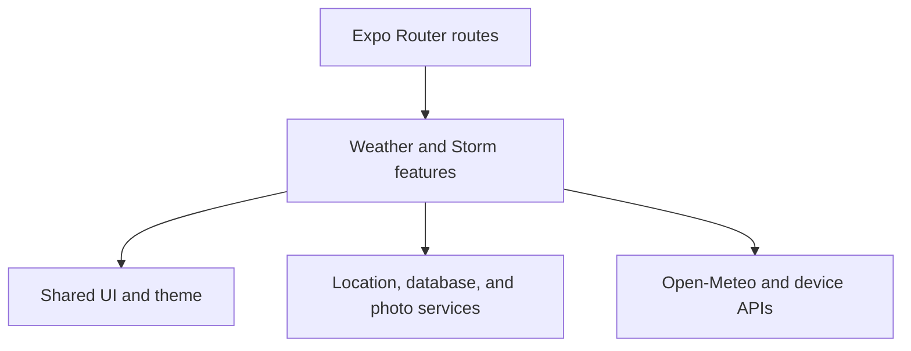
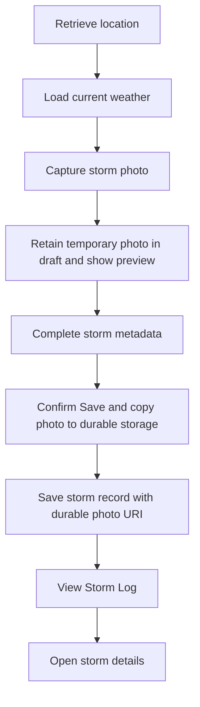
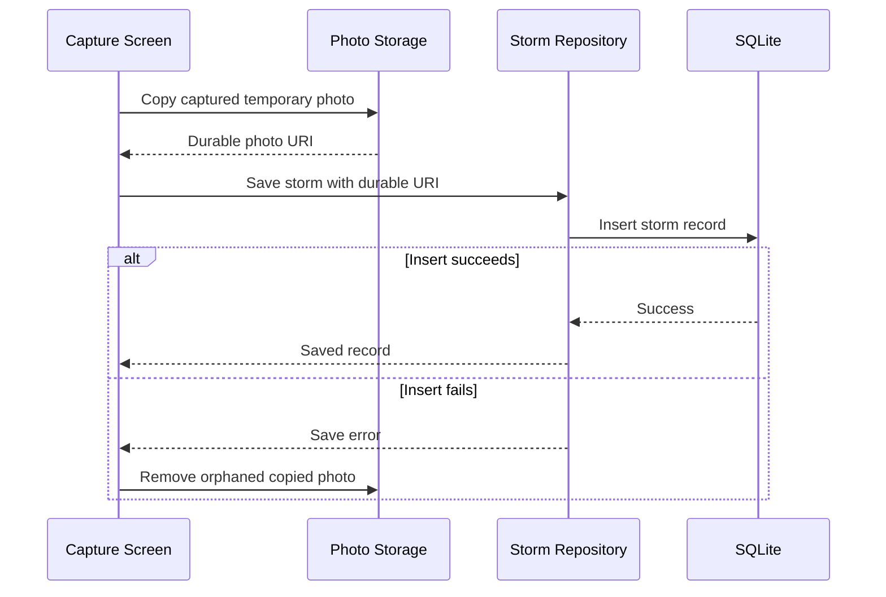

# Storm Chaser — Architecture and Implementation Plan

> [!important]
> This is the canonical architecture and milestone plan for the assessment. Codex may use it as implementation context, but it must implement only the milestone explicitly authorized in the current prompt.

## 1. Purpose

Build a reliable cross-platform Storm Chaser mobile application that allows hobbyist meteorologists to:

- Retrieve current weather for the device's location.
- Review storm-relevant weather metrics.
- Capture a storm photo using the device camera.
- Attach weather, coordinates, time, notes, and classification.
- Save storm observations locally.
- Browse and inspect saved observations.

Functionality, correctness, failure handling, readable code, testing, and documentation take priority over visual complexity.

---

## Execution Status

| Milestone | Status | Verification |
|---|---|---|
| 0 — Planning and scope control | Completed | Architecture, scope, stack and repository guidance established |
| 1 — Repository and application foundation | Completed | Repository records document foundation verification, but retain no command pass output; physical-device validation remains outstanding |
| 2 — Current weather vertical slice | Completed | `npm run typecheck`, `npm run lint`, 35 Jest tests, and Expo Doctor pass; user confirmed permission approval/denial, location acquisition, live weather, refresh, network recovery, and light/dark mode on a physical iOS device |
| 3 — Storm capture and metadata | Implemented — device verification pending | `npm run typecheck`, `npm run lint`, 55 Jest tests, and Expo Doctor pass; implementation and automated verification are complete, while physical-device camera, permission, location, keyboard, and theme checks remain pending |
| 4 — Persistence, Storm Log, and detail | Completed | Stable photo locators, legacy absolute-URI migration, strict type checking, lint, 85 Jest tests, and all 18 Expo Doctor checks pass; user confirmed all required manual iOS Save, failure/retry, log/detail, missing-state, restart-persistence, container-change, and theme checks |
| 5 — Offline behaviour and dark mode | Completed | SQLite weather cache, exact rounded-coordinate matching, NetInfo/TanStack reconnect handling, offline states, and dark-mode audit implemented; `npm run typecheck`, `npm run lint`, 100 Jest tests, and all 18 Expo Doctor checks pass; user confirmed all required manual iOS live/cache, airplane-mode, no-cache, offline capture/save/browsing, reconnect, restart, historical-snapshot, and light/dark checks |
| 6 — Conditional forecast | Not started | — |
| 7 — Test completion, accessibility, and documentation | Not started | — |
| 8 — Cross-platform QA and submission | Not started | — |

Allowed status values:

- `Not started`
- `In progress`
- `Implemented — device verification pending`
- `Completed`
- `Deferred`
- `Excluded`

Tracking rules:

- A milestone becomes `In progress` when its implementation begins.
- Codex may mark a milestone `Implemented — device verification pending` after implementation and automated verification.
- A milestone becomes `Completed` only after its acceptance criteria and required manual/device checks have been verified.
- Status updates must include verification evidence.
- Do not mark later milestones as started merely because supporting code was introduced by an earlier approved milestone.
- Only update milestone status as part of an explicitly authorized milestone or documentation task.

---

## 2. Locked Decisions

| Area | Decision |
|---|---|
| Framework | React Native with Expo |
| Language | TypeScript strict mode |
| Navigation | Expo Router |
| Weather API | Open-Meteo |
| Remote state | TanStack Query |
| Form state | React Hook Form |
| Local records | Expo SQLite |
| Photo storage | Expo FileSystem |
| Camera | Expo Image Picker system-camera flow |
| Location | Expo Location |
| Styling | React Native primitives and `StyleSheet` |
| Architecture | Feature-based, inspired by Bulletproof React |
| Platforms | iOS and Android |
| Committed bonuses | Offline support, pull-to-refresh, dark mode |
| Conditional bonus | Weather forecast |
| Explicit exclusions | Map visualization and cloud integration |
| Testing | Focused unit and component tests |

### 2.1 Scope rule

All required assessment features must be completed before forecast work begins.

Map visualization and cloud integration will not be implemented. This decision is final. Any remaining time will be invested in stability, accessibility, testing, cross-platform verification, documentation, and submission quality.

---

## 3. Architecture Style

Use a lightweight feature-based modular architecture.

The architecture should provide:

- Clear ownership of product behaviour.
- Separation between UI and external systems.
- Testable mapping and persistence logic.
- Predictable dependency direction.
- Minimal architectural ceremony.

It should not introduce:

- Full Clean Architecture layers.
- A dependency-injection container.
- Use-case classes for simple actions.
- Generic base repositories.
- Redux, Zustand, or another global client store without a demonstrated need.
- Empty or speculative directories.
- Abstractions created only to make the repository look complex.

### 3.1 High-level dependency flow



### 3.2 Dependency rules

- Route files may import feature screens and application providers.
- Feature screens may import their own feature components, hooks, models, and data modules.
- Features may import shared UI, theme, and external service modules.
- Shared components must not depend on product features.
- Service modules must not depend on screens or presentation components.
- Weather must not depend on storms.
- The storms workflow may consume the public current-weather hook/model because storm documentation requires a weather snapshot.
- Cross-feature dependencies must be intentional and one-directional.
- Do not move code into `shared`, `components`, or `utils` until it is genuinely reused.

---

## 4. Repository Structure

Create only directories that contain real files. The expected structure is:

```text
storm-chaser/
├── app/
│   ├── _layout.tsx
│   ├── (tabs)/
│   │   ├── _layout.tsx
│   │   ├── weather.tsx
│   │   ├── capture.tsx
│   │   └── storms.tsx
│   └── storms/
│       └── [id].tsx
├── src/
│   ├── app/
│   │   └── providers/
│   │       ├── app-providers.tsx
│   │       └── query-provider.tsx
│   ├── features/
│   │   ├── weather/
│   │   │   ├── api/
│   │   │   ├── components/
│   │   │   ├── hooks/
│   │   │   ├── model/
│   │   │   └── screens/
│   │   └── storms/
│   │       ├── components/
│   │       ├── data/
│   │       ├── hooks/
│   │       ├── model/
│   │       └── screens/
│   ├── services/
│   │   ├── database/
│   │   ├── location/
│   │   └── photo-storage/
│   ├── components/
│   └── theme/
├── docs/
│   ├── AI_USAGE.md
│   ├── TIME_LOG.md
│   └── MANUAL_TESTING.md
├── AGENTS.md
├── README.md
└── package.json
```

### 4.1 Directory responsibilities

| Directory | Responsibility |
|---|---|
| `app/` | Thin Expo Router route definitions and layouts |
| `src/app/providers/` | Application-wide provider composition |
| `features/weather/api/` | Open-Meteo transport and response types |
| `features/weather/model/` | Weather domain model and API mapping |
| `features/weather/hooks/` | Weather queries and weather orchestration |
| `features/weather/components/` | Weather-specific presentation |
| `features/weather/screens/` | Weather route-level screen implementation |
| `features/storms/model/` | Storm domain types and form validation |
| `features/storms/data/` | Storm repository and database row mapping |
| `features/storms/hooks/` | Storm queries, saves, deletion, and invalidation |
| `features/storms/components/` | Storm-specific UI and form controls |
| `features/storms/screens/` | Capture, list, and detail screens |
| `services/database/` | Database initialization and migrations |
| `services/location/` | Location permission and coordinate acquisition |
| `services/photo-storage/` | Durable image copy and removal |
| `components/` | Only genuinely shared UI states and primitives |
| `theme/` | Semantic colours, spacing, typography, and theme hook |

### 4.2 Folder rule

Subdirectories are used proactively when they communicate a real responsibility. Empty template directories must not be created. A feature does not need every possible Bulletproof React folder.

---

## 5. Navigation and Product Flow

### 5.1 Primary navigation

Use three tabs:

1. **Weather** — Current weather and refresh controls.
2. **Document** — Photo capture and storm metadata.
3. **Storm Log** — Saved storm observations.

Storm details open as a pushed route outside the tab list.

### 5.2 Core user journey



The weather and documentation features must feel connected. Weather, coordinates, and timestamp should be prefilled wherever available rather than requiring duplicate manual entry.

---

## 6. State Ownership

| State | Owner | Reason |
|---|---|---|
| Current/forecast weather | TanStack Query | Remote asynchronous state with cache, retry, refresh, and staleness |
| Weather cache persistence | Weather cache data module backed by SQLite | Supports cold-start offline fallback |
| Storm form fields | React Hook Form | Temporary validated input state |
| Captured photo preview | Storm capture screen/form workflow | Local draft state |
| Saved storm list/detail | Feature-local hooks calling the SQLite repository directly | SQLite is the local source of truth; reload on Save or focus |
| Navigation | Expo Router | Route and parameter state |
| Theme | System colour scheme plus theme hook | No global store required |
| Permission request UI | Feature hook/component state | Local transient behaviour |

### 6.1 Global state rule

Do not add Redux, Zustand, or another global store unless an actual implementation blocker demonstrates that existing ownership is insufficient. A desire to centralize state is not, by itself, sufficient justification.

---

## 7. Domain Model

### 7.1 Storm record

```text
StormRecord
- id: string
- photoUri: string
- capturedAt: ISO timestamp
- createdAt: ISO timestamp
- updatedAt: ISO timestamp
- latitude: number
- longitude: number
- locationAccuracyMetres: number | null
- stormType: StormType
- notes: string
- observedConditions: string
- weatherSnapshot: WeatherSnapshot | null
```

`observedConditions` provides a human-readable weather description. It is prefilled from live or cached weather and may be manually entered when network weather is unavailable.

### 7.2 Weather snapshot

```text
WeatherSnapshot
- temperatureCelsius: number
- apparentTemperatureCelsius: number | null
- relativeHumidityPercent: number | null
- surfacePressureHpa: number | null
- precipitationMm: number
- windSpeedKph: number
- windGustKph: number | null
- windDirectionDegrees: number | null
- weatherCode: number | null
- observedAt: ISO timestamp
- source: "live" | "cache"
```

The snapshot is stored with the storm. Relative humidity and surface pressure are part of that persisted immutable snapshot when available. Historical records must not display whatever the current weather happens to be when reopened.

### 7.3 Storm classification

```text
StormType
- thunderstorm
- tornado
- hail
- heavy-rain
- high-wind
- snowstorm
- other
```

Do not invent one numeric severity scale for unrelated storm types.

### 7.4 API and database types

Keep three representations explicit:

- Open-Meteo transport response
- Application/domain weather and storm models
- SQLite row representation

Map between them at boundaries. Do not pass unvalidated API objects or raw database rows directly into UI components.

---

## 8. Persistence Design

### 8.1 Storage responsibilities

- SQLite stores structured storm metadata and cached weather.
- Expo FileSystem stores durable photo files.
- SQLite stores the durable URI, not image bytes or base64.

### 8.2 Database schema

Use a minimal versioned migration system.

Initial tables:

#### `storms`

- `id`
- `photo_uri`
- `captured_at`
- `created_at`
- `updated_at`
- `latitude`
- `longitude`
- `location_accuracy_metres`
- `storm_type`
- `notes`
- `observed_conditions`
- Weather snapshot columns, including nullable `relative_humidity_percent` and `surface_pressure_hpa`

#### `weather_cache`

- Cache key derived from rounded coordinates
- Weather fields, including nullable `relative_humidity_percent` and `surface_pressure_hpa`
- Observation timestamp
- Cache timestamp

Do not add an ORM. Direct parameterized SQLite queries and explicit row mappers are sufficient.

### 8.3 Save transaction behaviour



Do not delete the temporary source photo until the save workflow no longer requires it.

### 8.4 Deletion behaviour

If record deletion is implemented:

1. Resolve the saved record and owned photo URI.
2. Delete the database record.
3. Remove the owned photo.
4. If file removal fails, report/log the cleanup limitation without restoring a deleted record unnecessarily.

Deletion is secondary to required capture and persistence. It may be omitted if time becomes constrained.

---

## 9. Weather Design

### 9.1 Required metrics

Display at minimum:

- Temperature
- Apparent temperature where available
- Relative humidity where available
- Surface pressure where available
- Wind speed
- Wind gusts where available
- Wind direction where available
- Precipitation
- Interpreted weather condition
- Observation/update time

### 9.2 Open-Meteo current-weather request and mapping

Request these Open-Meteo current-weather variables:

- `temperature_2m`
- `apparent_temperature`
- `relative_humidity_2m`
- `surface_pressure`
- `precipitation`
- `wind_speed_10m`
- `wind_gusts_10m`
- `wind_direction_10m`
- `weather_code`

Map `relative_humidity_2m` to `relativeHumidityPercent` and `surface_pressure` to `surfacePressureHpa`. Treat both fields as nullable at the domain boundary: a missing, null, or invalid transport value maps to `null`, not a fabricated default.

### 9.3 Query identity

Weather query keys should include rounded coordinates to prevent tiny GPS changes from creating excessive cache entries.

### 9.4 Weather states

The UI must distinguish:

- Initial/loading
- Live success
- Pull-to-refresh
- Cached/offline success
- Location permission denied
- Location services unavailable
- Weather not found
- Network/server failure
- Retry in progress

### 9.5 Not-found requirement

Provide an explicit **Weather not found** state when no usable weather can be retrieved. Do not mislabel every failure as not found.

### 9.6 Forecast condition

Forecast work begins only after:

- All required flows work.
- Persistence survives restart.
- Both platforms launch.
- Core permission and error states are verified.
- Required tests pass.
- Documentation is current.
- Sufficient time remains before the submission buffer.

If implemented, forecast should remain compact and storm-relevant: precipitation probability, wind/gusts, condition, and temperature.

---

## 10. Camera, Location, and Permissions

### 10.1 Camera

Use Expo Image Picker's system-camera flow. Do not build a custom in-app viewfinder.

Handle:

- Permission not yet requested
- Permission denied
- Permanent denial/open-settings guidance
- Camera unavailable
- User cancellation
- Missing returned asset
- File-copy failure

Cancellation is a normal outcome and must not be presented as an application error.

### 10.2 Location

Handle:

- Permission not yet requested
- Permission denied
- Permanent denial/open-settings guidance
- Location services disabled
- Acquisition timeout
- Missing coordinates
- Accuracy metadata where available
- Retry

GPS coordinates can still be obtained without network connectivity when device location services are available.

### 10.3 Permission UX

- Explain why access is needed before or alongside the request.
- Do not repeatedly prompt after denial.
- Provide a retry or Settings action where meaningful.
- Keep permission errors separate from network errors.

---

## 11. Offline Behaviour

Offline support is a committed bonus and means:

- Saved storms remain browsable.
- Saved photos remain visible.
- A storm can be documented and saved without network access.
- Coordinates are captured when location services remain available.
- Cached weather may be used and is clearly marked as cached.
- The last update time is visible.
- Manual observed conditions are available when no weather cache exists.
- Live weather can refresh after connectivity returns.
- An offline indicator communicates degraded state.

Offline support does not include cloud synchronization, background upload queues, or conflict resolution.

---

## 12. UI and Component Strategy

### 12.1 Styling

Use React Native primitives with `StyleSheet`.

Define semantic tokens for:

- Background
- Surface
- Elevated surface
- Primary text
- Secondary text
- Primary action
- Warning
- Error
- Border
- Spacing
- Radius
- Typography

Feature components must not scatter raw light-only colours.

### 12.2 Dark mode

- Follow the system colour scheme.
- Provide light and dark semantic values.
- Ensure cards, forms, buttons, errors, and text remain readable.
- A manual theme selector is not required.

### 12.3 Shared components

Expected genuinely shared components may include:

- Screen container
- Application button
- Application text input
- Loading state
- Error state
- Empty state
- Permission state
- Offline banner

Feature-owned examples:

- `WeatherMetric`
- `WeatherCard`
- `StormCard`
- `StormForm`
- `StormTypeSelector`

Do not create pass-through wrappers around every React Native primitive.

### 12.4 Accessibility

- Provide meaningful labels and roles.
- Maintain adequate touch target sizes.
- Do not encode meaning through colour alone.
- Ensure text contrast in both themes.
- Allow screen-reader users to understand weather metrics and storm cards.
- Ensure form errors are associated with their fields.

---

## 13. Error and Edge-Case Strategy

| Area | Required handling |
|---|---|
| Weather | Timeout, offline, non-success response, malformed data, not found, retry |
| Location | Denial, disabled services, timeout, missing coordinates, retry |
| Camera | Denial, cancellation, unavailable camera, missing asset |
| Filesystem | Copy failure, missing saved image, orphan cleanup |
| Database | Initialization failure, migration failure, save failure, read failure |
| Form | Missing classification, missing conditions, excessive notes, duplicate save taps |
| Navigation | Missing/invalid storm ID and deleted record |
| Offline | Cached weather versus no cache, stale timestamp, reconnect refresh |

### 13.1 Save rules

- Disable Save while persistence is in progress.
- Prevent duplicate submissions.
- Preserve entered form data after a recoverable save failure.
- Do not discard a valid observation because live weather is unavailable.
- Show actionable messages rather than raw exception text.

---

## 14. Testing Strategy

Use Jest and React Native Testing Library.

### 14.1 Unit tests

Prioritize:

- Open-Meteo response mapping, including relative humidity and surface pressure mappings and nullable-value handling
- Weather-code interpretation
- Storm validation
- Database row/domain mapping, including nullable snapshot relative humidity and surface pressure
- Weather snapshot creation, including immutable relative humidity and surface pressure values
- Query-key coordinate rounding
- Repository cleanup behaviour where practical

### 14.2 Component tests

Prioritize:

- Weather loading state
- Weather success state
- Weather not-found/error state
- Location permission-denied state
- Empty Storm Log
- Valid storm form submission
- Invalid form submission
- Cached/offline weather indicator

### 14.3 Manual verification

Document manual checks for:

- iOS startup
- Android startup
- Location approval and denial
- Camera approval, capture, and cancellation
- Online weather
- Offline startup
- Pull-to-refresh
- Save and restart persistence
- Photo survival after restart
- Light and dark modes
- Invalid storm detail route

### 14.4 Testing exclusions

- No broad snapshot-test suite.
- No required Detox setup.
- No coverage-percentage target.
- E2E automation is optional and must not displace required functionality or QA.

---

## 15. Platform Strategy

The application targets both iOS and Android.

Both platforms require:

- Correct permission descriptions/configuration
- Successful application startup
- Navigation smoke test
- Weather smoke test
- SQLite initialization
- Theme verification

Camera, location, persistence, and restart behaviour must receive deep verification on at least one physical device. The second platform should be tested using the best available physical device, simulator, or emulator environment.

Do not claim exhaustive device coverage.

---

## 16. Implementation Milestones

Codex must implement only the milestone explicitly authorized in the active prompt.

### Milestone 0 — Planning and scope control

**Goal:** Reconcile the remaining time budget and confirm the execution order.

**Deliverables:**

- Time log initialized
- Acceptance checklist confirmed
- Repository execution plan reviewed
- Hard stopping rule established

**Exit criteria:**

- Remaining time is known.
- Required and conditional scope are distinguished.
- Submission buffer is protected.

**Estimated active time:** 1 hour maximum, including architecture planning already completed.

---

### Milestone 1 — Repository and application foundation

**Goal:** Create a stable cross-platform application shell.

**Requirements covered:** Navigation foundation and platform setup.

**Deliverables:**

- Private repository
- Expo TypeScript project
- Expo Router configuration
- Application/query providers
- Three-tab navigation
- Placeholder feature screens
- Semantic light/dark theme tokens
- Type-check, lint, and test commands
- Initial `AGENTS.md`, time log, and AI disclosure files

**Acceptance criteria:**

- Application launches on the primary platform.
- Every route opens.
- TypeScript strict mode is enabled.
- Type checking and linting pass.
- No feature has been prematurely implemented.

**Explicitly excluded:** Weather integration, camera, location, SQLite records, forecast.

**Estimated active time:** 2.5 hours including repository setup.

---

### Milestone 2 — Current weather vertical slice

**Goal:** Display current weather using the device's location.

**Requirements covered:**

- Geolocation
- Weather API
- Meteorological metrics
- Not-found state
- Pull-to-refresh bonus

**Deliverables:**

- Location service and permission flow
- Open-Meteo client and response types
- Domain weather model and mapper
- Current-weather query hook
- Weather metric components for temperature, relative humidity, surface pressure, wind, and precipitation
- Loading, success, not-found, permission, and retry states
- Pull-to-refresh
- Weather mapper tests covering relative humidity and surface pressure mappings, including missing and invalid nullable values

**Acceptance criteria:**

- Location permission can be approved or denied safely.
- Current coordinates can be acquired.
- Temperature, relative humidity, surface pressure, wind, and precipitation render.
- Loading and refresh states are visible.
- Weather not found is explicitly represented.
- Network and permission errors remain distinct.
- Pull-to-refresh requests fresh data.
- Focused unit tests pass.
- The flow works on the primary physical device.

**Explicitly excluded:** Forecast, storm capture, local storm records, map, cloud.

**Estimated active time:** 3 hours.

---

### Milestone 3 — Storm capture and metadata

**Goal:** Capture a storm photo and complete its documentation draft.

**Requirements covered:**

- Camera capture
- Weather conditions
- Coordinates
- Date/time
- Notes
- Storm classification

**Deliverables:**

- Camera permission and system-camera launch
- Cancellation handling
- Photo preview
- Temporary captured-photo draft state and preview
- Storm model and validation
- React Hook Form metadata workflow
- Automatic weather, coordinate, and timestamp prefill
- Manual observed-conditions fallback

**Acceptance criteria:**

- Camera permission approval and denial are handled.
- User cancellation returns safely.
- Captured photo is previewed.
- The temporary photo URI remains available in the in-memory draft and is previewed without creating a permanent file.
- Required metadata is populated or entered.
- Invalid form submission is blocked with useful messages.
- Draft state survives recoverable form errors.

**Boundary:** Abandoning or cancelling a draft must not leave an app-owned permanent photo.

**Explicitly excluded:** Database save, Storm Log, forecast, map, cloud.

**Estimated active time:** 4 hours.

---

### Milestone 4 — Persistence, Storm Log, and detail

**Goal:** Persist complete storm observations and retrieve them after restart.

**Requirements covered:**

- Local persistence
- Proper data model/storage
- Navigation between documented storms

**Deliverables:**

- Database initialization and migration
- `storms` schema
- Storm row mapper and repository
- Save workflow with explicit saving, success, and recoverable-error states
- Storm Log list
- Empty state
- Storm detail screen
- Invalid/missing-record state
- Storm Log refresh after successful save
- On Save confirmation, copy the temporary photo into app-owned durable storage
- SQLite insert using the durable photo URI
- Orphaned-photo cleanup after failed insert
- Temporary source retention until the save workflow no longer requires it

**State ownership boundary:** TanStack Query remains responsible only for remote Open-Meteo state. SQLite remains the source of truth for storm records. The Storm Log reloads from SQLite after a successful Save or when the screen regains focus. Do not wrap SQLite reads or writes in TanStack Query hooks.

**Acceptance criteria:**

- Complete storm record saves locally.
- When the user confirms Save, the temporary photo is copied into app-owned durable storage.
- The SQLite record is inserted using the durable photo URI.
- If the database insert fails, the newly copied orphaned photo is deleted.
- The temporary source is not deleted until the save workflow no longer requires it.
- Duplicate Save taps are prevented.
- Storm appears in the log after saving.
- Storm detail displays photo and all metadata.
- Record survives application restart.
- Photo survives application restart.
- Missing record ID is handled safely.
- Save failures preserve recoverable user input.
- Relevant mapping and component tests pass.

**Conditional addition:** Record deletion and owned-photo cleanup if core persistence is stable.

**Explicitly excluded:** Forecast, map, cloud.

**Estimated active time:** 3.5 hours.

---

### Milestone 5 — Offline behaviour and dark mode

**Goal:** Complete the committed Senior bonuses that reinforce the core application.

**Deliverables:**

- Weather cache schema/data access
- Cache update after live weather success
- Cached-weather fallback
- Offline indicator
- Last-updated timestamp
- Reconnect refresh
- Offline storm documentation and browsing verification
- Complete light/dark theme application

**Acceptance criteria:**

- Saved storms and photos remain available offline.
- Storm documentation can be saved offline.
- Cached weather is clearly marked.
- No-cache offline state is understandable.
- Manual observed conditions allow offline documentation.
- Weather refreshes after connectivity returns.
- All core screens are readable in both themes.

**Explicitly excluded:** Background sync, cloud queue, map, cloud integration.

**Estimated active time:** 2 hours.

---

### Milestone 6 — Conditional forecast

**Entry conditions:**

- Every required acceptance criterion passes.
- Storm records and photos survive restart.
- Offline and dark-mode commitments work.
- Both platforms launch.
- Required tests pass.
- Documentation is current.
- Sufficient submission buffer remains.

**Goal:** Add a compact storm-relevant forecast.

**Deliverables:**

- Forecast fields from Open-Meteo
- Forecast mapping
- Compact forecast component
- Loading/error integration without destabilizing current weather

**Acceptance criteria:**

- Forecast shows relevant upcoming precipitation, wind/gust, condition, and temperature information.
- Current-weather behaviour remains unchanged.
- Forecast failure does not break current weather.

**Explicitly excluded:** Radar, weather maps, alerts, cloud.

**Estimated active time:** 1 hour maximum.

**Cut rule:** Skip the entire milestone if its entry conditions are not met.

---

### Milestone 7 — Test completion, accessibility, and documentation

**Goal:** Stabilize the repository and prepare reviewer-facing documentation.

**Deliverables:**

- Focused unit/component test suite
- Accessibility pass
- README
- Architecture and implementation decisions summary
- Setup and run instructions
- Known limitations
- AI usage disclosure
- Time log
- Manual test record

**Acceptance criteria:**

- Type checking passes.
- Linting passes.
- Tests pass.
- README instructions are accurate.
- AI usage is specific and honest.
- Actual time is recorded.
- Any incomplete requirement is documented explicitly.

**Estimated active time:** 3 hours.

---

### Milestone 8 — Cross-platform QA and submission

**Goal:** Verify the exact material the reviewer will receive.

**Deliverables:**

- iOS smoke test
- Android smoke test
- Primary physical-device native-flow test
- Standalone/development build verification
- 20–40 second screen recording
- Publicly accessible Drive link
- Submission PDF
- Private GitHub access for `developer@speer.io`

**Acceptance criteria:**

- Both platforms launch.
- Required workflow works on the primary test device.
- Video visibly demonstrates startup and core UI flow.
- Drive link works in a private/incognito session.
- PDF contains every requested item.
- Repository is private and the reviewer invitation is sent.
- No credentials or private files are committed.

**Estimated active time:** 2.5 hours.

---

## 17. Time Budget

The time log is authoritative. Reconcile this plan against time already spent before implementation.

| Work | Maximum allocation |
|---|---:|
| Planning and locked decisions | 1.0 h |
| Repository and foundation | 2.5 h |
| Current weather | 3.0 h |
| Storm capture and metadata | 4.0 h |
| Persistence, list, and detail | 3.5 h |
| Offline and dark mode | 2.0 h |
| Conditional forecast | 1.0 h |
| Tests, accessibility, and documentation | 3.0 h |
| Cross-platform QA and submission | 2.5 h |
| Debugging buffer | 1.5 h |
| **Total** | **24.0 h** |

If planning already exceeded its allocation, recover time in this order:

1. Remove forecast.
2. Remove optional deletion.
3. Reduce visual polish.
4. Narrow component-test breadth while retaining meaningful tests.

Do not recover time by removing durable persistence, permission handling, error states, restart verification, required documentation, video, or submission checks.

---

## 18. Hard Stopping Rule

When the submission buffer begins:

- No new feature may begin.
- No architectural restructuring may begin.
- No dependency upgrade may begin without a blocking reason.
- No optional animation or visual refinement may risk stability.

Remaining time is reserved for:

- Type checking
- Linting
- Tests
- Manual QA
- Cross-platform startup
- Physical-device verification
- README
- AI disclosure
- Time log
- Video
- PDF
- Repository and Drive access verification

---

## 19. Definition of Done

The assessment is complete only when:

- Current location weather works.
- Storm-relevant metrics are visible.
- Weather not found is represented.
- Camera capture works.
- Required metadata is collected.
- Captured photos are stored durably.
- Storm records persist locally.
- Storm Log and detail navigation work.
- Records and photos survive restart.
- Offline support, pull-to-refresh, and dark mode work.
- iOS and Android launch and receive smoke testing.
- Focused tests pass.
- README explains setup and decisions.
- AI usage is disclosed.
- Time spent is documented.
- Video is accessible.
- PDF contains every requested item.
- Private repository access is granted to the reviewer.

---

## 20. Codex Usage Rule

Before repository-wide planning, Codex should read this complete document.

For implementation, Codex should read:

1. `AGENTS.md`
2. The current milestone section in this document
3. Existing files relevant to that milestone

Each implementation prompt must explicitly state:

- The authorized milestone
- What is in scope
- What is out of scope
- Acceptance criteria
- Verification requirements

Codex must not begin a later milestone automatically.

---

## 21. References

- [Assessment weather API option: Open-Meteo](https://open-meteo.com/)
- [Expo documentation](https://docs.expo.dev/)
- [TanStack Query for React Native](https://tanstack.com/query/latest/docs/framework/react/react-native)
- [Bulletproof React project structure](https://github.com/alan2207/bulletproof-react/blob/master/docs/project-structure.md)
- [React Native testing overview](https://reactnative.dev/docs/testing-overview)
